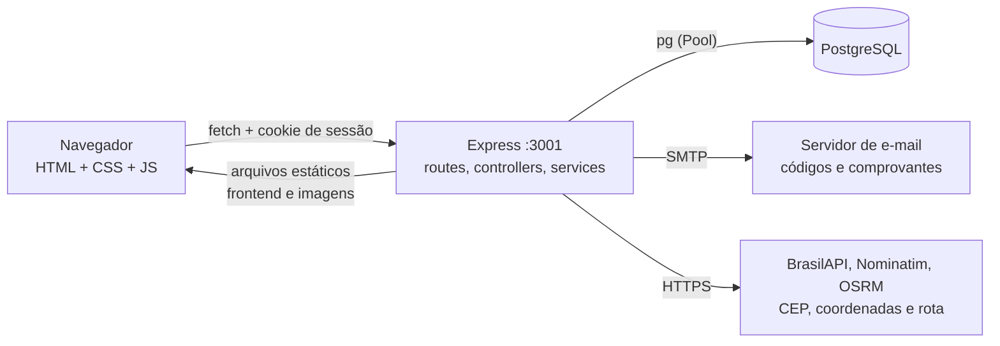
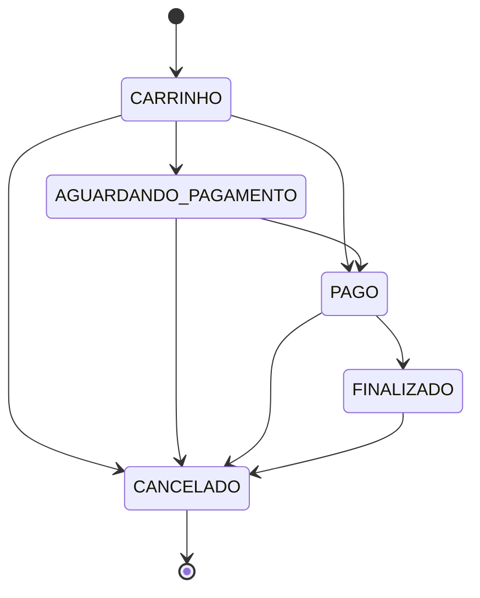
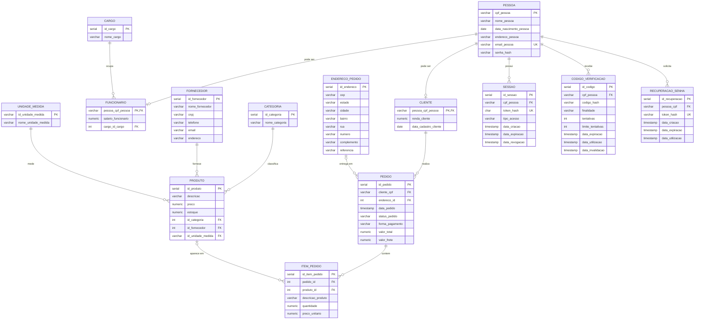

# Mercado V.2

Sistema web full-stack de **supermercado online**: o cliente navega pela loja, monta o carrinho, calcula o frete pelo CEP, paga (pagamento simulado) e acompanha seus pedidos; o gerente administra cadastros, estoque e pedidos. Projeto acadêmico.

## Sumário

- [1. Visão geral](#1-visão-geral)
- [2. Tecnologias e arquitetura](#2-tecnologias-e-arquitetura)
- [3. Execução rápida](#3-execução-rápida)
- [4. Pré-requisitos](#4-pré-requisitos)
- [5. Guia de execução passo a passo](#5-guia-de-execução-passo-a-passo)
- [6. Contas de demonstração](#6-contas-de-demonstração)
- [7. Como o sistema funciona](#7-como-o-sistema-funciona)
- [8. Estrutura do projeto](#8-estrutura-do-projeto)
- [9. Banco de dados](#9-banco-de-dados)
- [10. API REST](#10-api-rest)
- [11. Solução de problemas](#11-solução-de-problemas)
- [12. Limitações conhecidas](#12-limitações-conhecidas)

---

## 1. Visão geral

| Perfil | O que pode fazer |
|---|---|
| **Visitante** | Ver o catálogo e montar o carrinho (o carrinho fica salvo no navegador, em `localStorage`). |
| **Cliente** | Entrar com e-mail, senha e código por e-mail; finalizar compras com cálculo de frete; ver seus pedidos; editar seus dados. |
| **Gerente** | Acessar o painel administrativo: pessoas, cargos, categorias, fornecedores, unidades de medida, produtos (com imagem e reposição de estoque) e pedidos. |
| **Funcionário** (não gerente) | Consegue autenticar, mas só pode seguir para o cadastro como cliente; não há painel próprio para esse perfil. |

**Regras de negócio principais**

- **Entrega somente em Campo Mourão – PR.** O frete é de R$ 5,00 para até 1 km de rota e, acima disso, R$ 5,00 + R$ 1,50 por km. O valor é calculado no servidor (CEP via BrasilAPI, coordenadas via Nominatim/OpenStreetMap e rota via OSRM) e protegido por um token assinado, válido por 15 minutos.
- **Pagamento simulado** (PIX, crédito, débito ou dinheiro): não há gateway de pagamento. Ao finalizar, o pedido passa a `PAGO` e o estoque é baixado automaticamente por *triggers* do banco.
- **Autenticação em duas etapas por e-mail**: todo login exige um código de 6 dígitos (validade de 5 minutos, até 5 tentativas). Por isso **é necessário configurar um servidor SMTP** para usar o sistema (ver [5.5](#55-configurar-o-envio-de-e-mail-gmail)).

---

## 2. Tecnologias e arquitetura

| Camada | Tecnologias |
|---|---|
| Frontend | HTML5, CSS3 e JavaScript puro (sem framework e sem build) |
| Backend | Node.js 20+, Express 4, `pg`, `cookie-parser`, `cors`, `dotenv`, `multer`, `sharp`, `nodemailer` |
| Banco | PostgreSQL (extensão `pgcrypto` para hash de senha com bcrypt) |
| Serviços externos | BrasilAPI (CEP), Nominatim/OpenStreetMap (geocodificação), OSRM (rota) |



O próprio Express serve o frontend: **não é preciso um servidor web separado**.

---

## 3. Execução rápida

> Para quem já tem Node.js 20+, PostgreSQL e uma conta Gmail com senha de app. Os detalhes de cada passo estão na [seção 5](#5-guia-de-execução-passo-a-passo).

```bash
# 1. Entre na pasta que contém o package.json (Mercado-V2) e instale as dependências
npm install

# 2. Crie e popule o banco (ajuste o usuário, se necessário)
psql -U postgres -c "CREATE DATABASE mercado_v2;"
psql -U postgres -d mercado_v2 -f documentacao/Banco_Mercado_V2.sql

# 3. Crie o arquivo backend/.env  (modelo na seção 5.4)

# 4. Troque o e-mail das contas de demonstração pelo seu (seção 5.6)

# 5. Suba o servidor
npm start
```

Abra **http://127.0.0.1:3001** (use `127.0.0.1`, não `localhost` — veja o motivo em [5.8](#58-acessar-o-sistema)).

---

## 4. Pré-requisitos

| Item | Versão | Observação |
|---|---|---|
| Node.js | **20 ou superior** | O `nodemailer` 10 exige Node 20+. O `npm` vem junto. |
| PostgreSQL | 13 ou superior | A partir da 13 o dono do banco pode criar a extensão `pgcrypto`; em versões anteriores é preciso ser superusuário. |
| `psql` | — | Acompanha o PostgreSQL. Alternativa: pgAdmin. |
| Conta de e-mail com SMTP | — | **Obrigatória** para login, cadastro e recuperação de senha. O guia usa Gmail com senha de app. |
| Internet | — | Necessária para o cálculo de frete (BrasilAPI, Nominatim, OSRM) e para o envio de e-mails. |
| Git | opcional | Só para clonar o repositório. |

Conferir as versões:

```bash
node -v      # v20.x ou superior
psql --version
```

---

## 5. Guia de execução passo a passo

### 5.1 Obter o projeto

```bash
git clone https://github.com/gabriel-UTFPR/GabrielSoares_4-bim_MercadoV.2.git
cd GabrielSoares_4-bim_MercadoV.2/Mercado-V2
```

Se recebeu o projeto em `.zip`, extraia-o e entre na pasta **`Mercado-V2`** (a que contém `package.json`, `backend/` e `frontend/`).

> No repositório, o projeto fica dentro da subpasta `Mercado-V2`. Todos os comandos deste guia partem dessa pasta, chamada aqui de **raiz do projeto**.

### 5.2 Instalar as dependências

```bash
npm install
```

- Execute na **raiz do projeto** (onde está o `package.json`), e não dentro de `backend/`.
- **Se o projeto veio em `.zip` com a pasta `node_modules`, apague-a antes.** Ela contém o binário do `sharp` compilado para Windows (`@img/sharp-win32-x64`), que não funciona em Linux/macOS e pode quebrar em outra versão do Node.

  ```bash
  rm -rf node_modules && npm install                      # Linux / macOS
  Remove-Item -Recurse -Force node_modules; npm install   # Windows PowerShell
  ```

### 5.3 Criar e popular o banco de dados

Conecte-se como superusuário (`psql -U postgres`) e crie um usuário e um banco dedicados:

```sql
CREATE USER mercado WITH PASSWORD 'troque_esta_senha';
CREATE DATABASE mercado_v2 OWNER mercado;
```

Depois, execute o script completo (cria as tabelas, *triggers* e dados de demonstração):

```bash
psql -U mercado -h localhost -d mercado_v2 -f documentacao/Banco_Mercado_V2.sql
```

> Alternativa mais simples: usar o próprio usuário `postgres` (`psql -U postgres -d mercado_v2 -f documentacao/Banco_Mercado_V2.sql`) e colocar `DB_USER=postgres` no `.env`.
> Sem `psql` no PATH (comum no Windows)? Abra o **pgAdmin**, conecte no banco `mercado_v2`, abra *Query Tool*, carregue o arquivo `documentacao/Banco_Mercado_V2.sql` e execute (F5).

**O que saber sobre o script**

- Ele começa com `DROP TABLE ... CASCADE`: **rodar de novo apaga todos os dados e recria o banco do zero**. Use isso a seu favor para "resetar" o ambiente.
- No final executa vários `SELECT` de conferência; uma saída longa no terminal é normal.
- O nome do banco é livre. O repositório original usa `Mercado V.2` (com espaço e ponto), que exige aspas em todos os comandos; `mercado_v2` evita o problema. Basta que `DB_NAME` no `.env` seja igual ao nome criado.

**Conferir se deu certo**

```bash
psql -U mercado -h localhost -d mercado_v2 -c "SELECT (SELECT count(*) FROM pessoa) AS pessoas, (SELECT count(*) FROM produto) AS produtos, (SELECT count(*) FROM pedido) AS pedidos;"
```

Resultado esperado: `20 | 71 | 5`.

### 5.4 Configurar o arquivo `.env`

Crie o arquivo **`backend/.env`** (dentro da pasta `backend`, não na raiz) com o conteúdo abaixo e ajuste os valores:

```env
# ---------- Servidor ----------
PORT=3001

# ---------- Banco de dados (PostgreSQL) ----------
DB_HOST=localhost
DB_PORT=5432
DB_NAME=mercado_v2
DB_USER=mercado
DB_PASSWORD=troque_esta_senha

# ---------- E-mail (SMTP) - obrigatório para login e cadastro ----------
SMTP_HOST=smtp.gmail.com
SMTP_PORT=465
SMTP_USER=seu.email@gmail.com
SMTP_PASS=xxxx xxxx xxxx xxxx

# ---------- Segredos: gere os seus (comando abaixo) ----------
CODIGO_VERIFICACAO_SECRET=cole_aqui_uma_chave_aleatoria
FRETE_SECRET=cole_aqui_outra_chave_aleatoria

# ---------- Opcionais ----------
NOMINATIM_EMAIL=seu.email@gmail.com
TESTE_EMAIL=seu.email@gmail.com
```

Para gerar cada segredo (rode duas vezes, uma para cada variável):

```bash
node -e "console.log(require('crypto').randomBytes(32).toString('hex'))"
```

| Variável | Obrigatória | Para que serve |
|---|---|---|
| `DB_HOST`, `DB_PORT`, `DB_NAME`, `DB_USER`, `DB_PASSWORD` | Sim | Conexão com o PostgreSQL. Se faltar alguma, o servidor nem inicia e informa qual. |
| `PORT` | Não (padrão `3001`) | Porta do servidor. **Mantenha `3001`**: o frontend usa essa porta fixa (ver [12](#12-limitações-conhecidas)). |
| `SMTP_HOST`, `SMTP_PORT`, `SMTP_USER`, `SMTP_PASS` | Sim, para logar | Envio dos códigos de verificação e dos comprovantes de pedido. |
| `CODIGO_VERIFICACAO_SECRET` | Sim | Chave HMAC usada para guardar os códigos de 6 dígitos (só o hash vai para o banco). |
| `FRETE_SECRET` | Sim, para comprar | Assina o token do frete. **Mínimo de 16 caracteres.** |
| `NOMINATIM_EMAIL` | Não | Identifica seu contato nas consultas ao Nominatim (boa prática da política de uso). |
| `TESTE_EMAIL` | Não | Usada apenas pelos scripts `testarCodigo.js` e `testarValidacaoCodigo.js`. |

> **Não** defina `NODE_ENV=production` ao rodar localmente: isso liga o atributo `secure` do cookie de sessão e o login deixa de funcionar em `http://`.
> **Nunca** faça commit do `.env` (ele já está no `.gitignore`) nem compartilhe o `.zip` com ele dentro.

### 5.5 Configurar o envio de e-mail (Gmail)

1. Na conta Google, ative a **verificação em duas etapas**.
2. Gere uma **senha de app** em <https://myaccount.google.com/apppasswords> (16 caracteres, exibidos em 4 grupos).
3. No `.env`, use o Gmail em `SMTP_USER` e a senha de app em `SMTP_PASS`. Mantenha `SMTP_PORT=465` (o código só ativa SSL implícito nessa porta).
4. Teste a conexão. O script lê o `.env` da pasta em que é executado, então rode **de dentro de `backend/`**:

   ```bash
   cd backend
   node testarEmail.js
   ```

   Saída esperada: `Conexão com o Gmail realizada com sucesso!`

Outros provedores funcionam com qualquer SMTP que exija usuário e senha (porta 465 = SSL; portas como 587 ou 2525 usam STARTTLS). Caixas de teste, como o Mailtrap, devem servir para desenvolvimento, mas não foram testadas neste projeto.

### 5.6 Ajustar o e-mail das contas de demonstração

O login envia o código para o e-mail cadastrado na conta, e os e-mails do script SQL não são seus. **Antes do primeiro login**, troque o e-mail de pelo menos uma conta de gerente e uma de cliente por endereços que você consiga abrir:

```sql
-- Gerente de demonstração (CPF 16175628900)
UPDATE public.pessoa SET email_pessoa = 'seu.email@gmail.com'
WHERE cpf_pessoa = '16175628900';

-- Cliente de demonstração (João Oliveira). O e-mail é único por pessoa;
-- no Gmail, use "+alias" para receber na mesma caixa de entrada.
UPDATE public.pessoa SET email_pessoa = 'seu.email+cliente@gmail.com'
WHERE cpf_pessoa = '10000000280';
```

Execute com o `psql` (`psql -U mercado -h localhost -d mercado_v2 -c "..."`) ou pelo pgAdmin.

> Alternativa para o lado cliente: criar uma conta nova em `/cadastro/cadastro.html`, com um CPF válido, seu e-mail e senha de pelo menos 8 caracteres. O cadastro só conclui após informar o código recebido por e-mail.

### 5.7 Iniciar o servidor

```bash
npm start        # execução normal
npm run dev      # com nodemon: reinicia sozinho ao salvar arquivos
```

Saída esperada:

```
=================================
Servidor executando na porta 3001
Banco de Dados conectado com sucesso!
=================================
```

Se aparecer `Falha na conexão com o banco de dados`, veja a [seção 11](#11-solução-de-problemas).

### 5.8 Acessar o sistema

> **Use sempre `http://127.0.0.1:3001`, e não `localhost`.**
> O frontend chama a API em `http://127.0.0.1:3001` (endereço fixo no código) e usa cookie de sessão. Abrir a página por `localhost` a torna "outra origem": o CORS bloqueia as chamadas e o cookie não é enviado.
> Não é necessário o Live Server: o Express já serve o frontend. Se mesmo assim preferir usá-lo, abra por `http://127.0.0.1:5500` (porta liberada no CORS).

Endereços principais (base `http://127.0.0.1:3001`):

| Tela | Endereço |
|---|---|
| Loja (página inicial) | `/` ou `/loja` |
| Login | `/login/login.html` |
| Cadastro de cliente | `/cadastro/cadastro.html` |
| Recuperação de senha | `/recuperacao/recuperacao.html` |
| Meus pedidos | `/visaoCliente/meusPedidos/pedidos.html` |
| Minha conta | `/visaoCliente/minhaConta/conta.html` |
| Checkout (nesta ordem) | `/visaoCliente/checkout/revisao/revisao.html` → `.../endereco/endereco.html` → `.../pagamento/pagamento.html` → `.../finalizado/finalizado.html` |
| Painel do gerente | `/visaoGerente/menu/menu.html` |
| CRUDs do gerente | `/visaoGerente/{pessoa, produto, categoria, fornecedor, cargo, unidade_medida, pedido}/<nome>.html` |

### 5.9 Roteiro de teste (cerca de 5 minutos)

**Como cliente**

1. Abra `http://127.0.0.1:3001`, adicione alguns produtos ao carrinho e clique em finalizar.
2. Entre com o e-mail do cliente ajustado em 5.6 e a senha `Mercado123!`; digite o código recebido por e-mail.
3. Na revisão do pedido, siga para o endereço e informe um **CEP válido de Campo Mourão – PR** (o frete é calculado pela internet).
4. Escolha a forma de pagamento e conclua. Confira o pedido em *Meus pedidos* e a baixa no estoque.

**Como gerente**

1. Entre com o e-mail do gerente ajustado em 5.6 (senha `Mercado123!`) e escolha **Gerente** na tela de acesso.
2. No painel, abra **Pedido** para ver o pedido da etapa anterior e alterar seu status; abra **Produto** para repor estoque ou trocar a imagem.

---

## 6. Contas de demonstração

Todas as contas criadas pelo script SQL usam a senha **`Mercado123!`**. O login é feito por **e-mail** (consulte-os com `SELECT cpf_pessoa, nome_pessoa, email_pessoa FROM public.pessoa;`) e exige o código enviado a esse e-mail; por isso o passo [5.6](#56-ajustar-o-e-mail-das-contas-de-demonstração).

| Perfil | CPF | Nome | O que acontece no login |
|---|---|---|---|
| Gerente (funcionário, cargo *Gerente*) | `16175628900` | Gabriel Pereira | Escolhe entre **Gerente** ou **Cadastrar como cliente** (não é cliente). |
| Cliente | `10000000280` | João Oliveira | Entra direto na loja. |
| Cliente | `10000000361` | Maria Santos | Entra direto na loja. |
| Cliente | `10000000108` | Gabriel Soares | Entra direto na loja. |
| Funcionário (não gerente) | `10000001252` | Mateus Ribeiro (Operador de Caixa) | Só pode seguir para o cadastro como cliente. |

O script cria 10 clientes (CPFs `10000000108` a `10000001090`) e 10 funcionários (um para cada cargo). Se uma mesma pessoa for gerente **e** cliente, ela pode alternar entre os dois acessos.

---

## 7. Como o sistema funciona

### 7.1 Login em duas etapas

1. `POST /auth/login` valida e-mail e senha (hash bcrypt via `pgcrypto`) e envia um código de 6 dígitos ao e-mail.
2. `POST /auth/validar-login` confere o código (válido por 5 minutos, até 5 tentativas).
3. Conforme os vínculos da pessoa no banco, o sistema entra direto como **cliente** ou pede para **escolher o acesso** (`POST /auth/escolher-acesso`): Gerente, Cliente ou Cadastrar como cliente.
4. A sessão é um token aleatório guardado em cookie `HttpOnly` (`sessao`), com validade de 30 dias; só o hash SHA-256 do token fica no banco (tabela `sessao`).

O cadastro de cliente (`/auth/cadastro`) e a recuperação de senha (`/auth/recuperar-senha`) seguem o mesmo princípio: código de 6 dígitos por e-mail.

### 7.2 Fluxo de compra

1. O carrinho vive no navegador (`localStorage`); fazer o pedido exige login como **cliente**.
2. `POST /frete/calcular` consulta CEP, coordenadas e rota, e devolve o frete junto com um token assinado (válido por 15 minutos).
3. `POST /pedido/finalizar` recebe itens, endereço, forma de pagamento e o token. O servidor **lê preço e descrição direto do banco e recalcula o frete** (não confia no navegador), valida o estoque (só produtos em `KG` aceitam quantidade decimal), cria o pedido e os itens e o marca como `PAGO` na mesma transação. As *triggers* baixam o estoque.
4. O sistema tenta enviar um comprovante por e-mail.

### 7.3 Status do pedido

Transições permitidas ao gerente (`PUT /pedido-admin/:id`):



Efeitos no estoque (feitos pelo banco): ao virar `PAGO`, o estoque é baixado (erro se for insuficiente); ao ser cancelado a partir de `PAGO` ou `FINALIZADO`, o estoque é devolvido.

---

## 8. Estrutura do projeto

```
Mercado-V2/
├── package.json                  # dependências e scripts (npm start / npm run dev)
├── backend/
│   ├── server.js                 # ponto de entrada: CORS, rotas e arquivos estáticos
│   ├── database.js               # pool do PostgreSQL; carrega backend/.env
│   ├── .env                      # configurações locais (NÃO versionar)
│   ├── controllers/              # regras de cada módulo (auth, cadastro, produto, pedido, ...)
│   ├── routes/                   # mapeamento URL -> controller
│   ├── middlewares/              # autenticação e autorização (cliente / gerente)
│   ├── services/                 # e-mail, código de verificação, sessão e frete
│   └── testar*.js                # scripts de diagnóstico (banco, e-mail, códigos)
├── frontend/
│   ├── login/  cadastro/  recuperacao/
│   ├── visaoCliente/             # loja, checkout (revisao, endereco, pagamento, finalizado),
│   │                             #   meusPedidos, minhaConta
│   └── visaoGerente/             # menu, pessoa, produto, categoria, fornecedor,
│                                 #   cargo, unidade_medida, pedido
├── imagens/                      # imagens dos produtos (<id_produto>.png) e ícones
└── documentacao/
    └── Banco_Mercado_V2.sql      # script completo: tabelas, triggers e dados de demonstração
```

Cada tela do frontend é um trio `nome.html`, `nome.css` e `nome.js`. As imagens de produtos são salvas como `imagens/<id>.png` (300×300, convertidas pelo `sharp` no upload).

---

## 9. Banco de dados

SGBD: PostgreSQL. Arquivo: [`documentacao/Banco_Mercado_V2.sql`](documentacao/Banco_Mercado_V2.sql). São **14 tabelas**.

### 9.1 Diagrama entidade-relacionamento



`pessoa` é a entidade central: `cliente` e `funcionario` são especializações 1:1 (a chave primária é também chave estrangeira), então uma mesma pessoa pode ser cliente, funcionário, ambos ou nenhum. O acesso de **gerente** não é uma tabela: é um funcionário cujo cargo se chama `Gerente`.

### 9.2 Dicionário de tabelas

| Tabela | Chave primária | Descrição |
|---|---|---|
| `pessoa` | `cpf_pessoa` | Cadastro geral de pessoas físicas, com e-mail único e senha (`senha_hash`, bcrypt). |
| `cliente` | `pessoa_cpf_pessoa` | Pessoas que compram: renda e data de cadastro. |
| `funcionario` | `pessoa_cpf_pessoa` | Pessoas que trabalham no mercado: salário e cargo. |
| `cargo` | `id_cargo` | Cargos (Gerente, Operador de Caixa, Repositor, ...). |
| `categoria` | `id_categoria` | Categorias de produtos (Bebidas, Limpeza, Hortifruti, ...). |
| `unidade_medida` | `id_unidade_medida` | Unidades (`UN`, `KG`, `L`, `ML`, `PC`). |
| `fornecedor` | `id_fornecedor` | Fornecedores com CNPJ, contato e endereço. |
| `produto` | `id_produto` | Itens à venda: preço, estoque (3 casas decimais, aceita venda por peso) e vínculos com categoria, fornecedor e unidade. |
| `endereco_pedido` | `id_endereco` | Endereços de entrega; um endereço pode servir a vários pedidos. |
| `pedido` | `id_pedido` | Pedido do cliente. `valor_total` é só o subtotal dos produtos; o frete fica em `valor_frete`. |
| `item_pedido` | `id_item_pedido` | Produtos do pedido, com **descrição e preço gravados no momento da compra**. |
| `sessao` | `id_sessao` | Sessões de login (hash do token, tipo de acesso, expiração e revogação). |
| `codigo_verificacao` | `id_codigo` | Códigos de 6 dígitos (hash) para `ATIVACAO`, `LOGIN` e `RECUPERACAO`, com contagem de tentativas. |
| `recuperacao_senha` | `id_recuperacao` | Tokens de redefinição de senha (hash, expiração e uso). |

**Restrições relevantes**

- `pedido.status_pedido`: `CARRINHO`, `AGUARDANDO_PAGAMENTO`, `PAGO`, `CANCELADO`, `FINALIZADO`.
- `pedido.forma_pagamento`: `PIX`, `CREDITO`, `DEBITO`, `DINHEIRO`.
- `sessao.tipo_acesso`: `CLIENTE`, `GERENTE`, `FUNCIONARIO`.
- `produto.preco >= 0` e `produto.estoque >= 0`; `item_pedido.quantidade > 0`.
- Excluir um `pedido` apaga seus itens (`CASCADE`); excluir um `produto` mantém o item do pedido com `produto_id` nulo (`SET NULL`); excluir um `cliente` com pedidos é bloqueado (`RESTRICT`); excluir uma `pessoa` apaga suas sessões, códigos e tokens (`CASCADE`).

### 9.3 Regras implementadas no banco (triggers)

| Trigger | Quando dispara | O que faz |
|---|---|---|
| `item_pedido_validar_estoque` | Antes de inserir/alterar item | Recusa o item se a quantidade for maior que o estoque. |
| `pedido_baixar_estoque_ao_pagar` | Antes de o status virar `PAGO` | Baixa o estoque dos itens; erro se algum for insuficiente. |
| `item_pedido_atualizar_valor_total` | Depois de inserir/alterar/excluir item | Recalcula `pedido.valor_total` (soma de quantidade × preço, sem frete). |
| `pedido_devolver_estoque_ao_cancelar` | Depois de o status virar `CANCELADO` | Se o pedido estava `PAGO` ou `FINALIZADO`, devolve o estoque. |

### 9.4 Dados de demonstração

20 pessoas (10 clientes e 10 funcionários), 10 cargos, 10 categorias, 10 fornecedores, 5 unidades de medida, **71 produtos** (com imagens em `imagens/1.png` a `71.png`), 5 pedidos de exemplo (um em cada status) com seus itens e 5 endereços de entrega em Campo Mourão.

---

## 10. API REST

URL base: `http://127.0.0.1:3001`. As respostas seguem o padrão `{ "sucesso": true|false, "mensagem": "...", ... }`. Rotas marcadas com **sessão** exigem o cookie `sessao` (enviado com `credentials: 'include'`).

| Módulo | Rotas | Acesso |
|---|---|---|
| **Autenticação** | `POST /auth/login`, `/auth/validar-login`, `/auth/escolher-acesso` | Público (usa cookies temporários) |
| | `POST /auth/cadastro`, `/auth/validar-cadastro`, `/auth/reenviar-codigo-cadastro` | Público |
| | `POST /auth/recuperar-senha`, `/auth/validar-codigo-recuperacao`, `/auth/redefinir-senha` | Público |
| | `GET /auth/minha-sessao`, `POST /auth/trocar-acesso`, `POST /auth/logout` | Sessão |
| **Frete** | `POST /frete/calcular` | Sessão de **cliente** |
| **Endereço** | `GET /endereco-pedido/ultimo` | Sessão de **cliente** |
| **Pedido (cliente)** | `POST /pedido/finalizar` | Sessão (apenas cliente conclui) |
| **Área do cliente** | `GET /cliente-area/pedidos`, `GET /cliente-area/dados`, `PUT /cliente-area/dados` | Sessão |
| **Pedido (gerente)** | `GET /pedido-admin`, `GET /pedido-admin/:id`, `PUT /pedido-admin/:id` | Sessão de **gerente** |
| **Produto** | `GET /produto/listar`, `GET /produto/:id`, `POST /produto`, `PUT /produto/:id`, `DELETE /produto/:id`, `POST /produto/:id/repor-estoque`, `POST /produto/upload/:id` (multipart, campo `imagem`) | Ver nota abaixo |
| **Categoria, Cargo, Fornecedor, Unidade de medida** | `GET /<modulo>/listar`, `GET /<modulo>/:id`, `POST /<modulo>`, `PUT /<modulo>/:id`, `DELETE /<modulo>/:id` (módulos: `categoria`, `cargo`, `fornecedor`, `unidade_medida`) | Ver nota abaixo |
| **Pessoa, Cliente, Funcionário** | `GET /<modulo>`, `GET /<modulo>/:id`, `POST /<modulo>`, `PUT /<modulo>/:id`, `DELETE /<modulo>/:id` (o `:id` é o CPF) | Ver nota abaixo |
| **Arquivos** | `GET /` e `GET /loja` (loja), `GET /imagens/:arquivo`, demais arquivos de `frontend/` | Público |

> **Nota:** hoje os CRUDs de cadastros (produto, categoria, cargo, fornecedor, unidade de medida, pessoa, cliente e funcionário) **não exigem autenticação no backend**; a proteção existe apenas nas telas do gerente. Veja [12](#12-limitações-conhecidas).

---

## 11. Solução de problemas

| Sintoma | Causa provável | Solução |
|---|---|---|
| `A variável de ambiente 'DB_...' não está definida no arquivo .env` | O `.env` não está em `backend/` ou falta uma variável. | Crie/corrija `backend/.env` (seção [5.4](#54-configurar-o-arquivo-env)). |
| `Falha na conexão com o banco de dados` com `password authentication failed` | Usuário ou senha do `.env` diferentes dos do PostgreSQL. | Confira `DB_USER` e `DB_PASSWORD`. |
| `Falha na conexão...` com `database "..." does not exist` | `DB_NAME` diferente do banco criado. | Use o mesmo nome do `CREATE DATABASE`. |
| `Falha na conexão...` com `ECONNREFUSED` | PostgreSQL parado ou porta errada. | Inicie o serviço do PostgreSQL e confira `DB_HOST`/`DB_PORT`. |
| `permission denied to create extension "pgcrypto"` ao importar o SQL | Usuário sem permissão (PostgreSQL anterior à 13 ou usuário não é dono do banco). | Importe como `postgres` ou rode `CREATE EXTENSION pgcrypto;` como superusuário. |
| `relation "public.pessoa" does not exist` | O script SQL não foi executado nesse banco. | Rode o `.sql` conectado ao banco certo. |
| `Address already in use` / `EADDRINUSE` | A porta 3001 já está ocupada. | Encerre o outro processo. Mudar `PORT` exige alterar a URL fixa em todos os `.js` do frontend. |
| `Cannot find module 'sharp'` ou erro de binário do `sharp` | `node_modules` copiado de outro sistema (Windows) ou versão de Node incompatível. | Apague `node_modules` e rode `npm install` (seção [5.2](#52-instalar-as-dependências)). |
| `Não foi possível iniciar o login. Verifique o serviço de e-mail.` | SMTP não configurado ou credenciais inválidas. | Configure `SMTP_*` e teste com `node testarEmail.js` dentro de `backend/`. |
| `Invalid login` / `Username and Password not accepted` ao testar o e-mail | Senha comum do Gmail em vez de **senha de app**. | Gere uma senha de app (seção [5.5](#55-configurar-o-envio-de-e-mail-gmail)). |
| O código nunca chega | O e-mail da conta no banco não é o seu. | Atualize o e-mail da pessoa (seção [5.6](#56-ajustar-o-e-mail-das-contas-de-demonstração)); olhe também o spam. |
| `E-mail ou senha incorretos` com conta de demonstração | Senha errada ou e-mail alterado. | A senha do script é `Mercado123!`; confira o e-mail com um `SELECT` em `pessoa`. |
| Login "funciona" mas a página volta para o login / chamadas bloqueadas pelo CORS | Página aberta por `localhost` em vez de `127.0.0.1`. | Acesse `http://127.0.0.1:3001` ([5.8](#58-acessar-o-sistema)). |
| Login não persiste | `NODE_ENV=production` definido localmente (cookie `secure`). | Remova a variável de ambiente. |
| `FRETE_SECRET não configurado no .env (mínimo de 16 caracteres)` | Variável ausente ou curta. | Gere um segredo com o comando da seção [5.4](#54-configurar-o-arquivo-env). |
| Erro ou demora no cálculo do frete | Sem internet ou serviço externo (BrasilAPI, Nominatim, OSRM) lento; CEP fora de Campo Mourão – PR. | Verifique a conexão, tente novamente e use um CEP de Campo Mourão. |
| Produtos sem foto | Falta o arquivo `imagens/<id>.png`. | Mantenha a pasta `imagens/` ou envie a imagem pela tela de produtos. |

---

## 12. Limitações conhecidas

Pontos observados na leitura do código. Não impedem a execução, mas vale conhecê-los:

- **CRUDs sem autenticação no backend.** Só `/pedido-admin` exige sessão de gerente; as rotas de produto, categoria, cargo, fornecedor, unidade de medida, pessoa, cliente e funcionário podem ser chamadas por qualquer pessoa que alcance a API. Use apenas em ambiente local/acadêmico, ou proteja essas rotas com `autenticarUsuario` e `autorizarGerente` antes de publicar.
- **Endereço da API fixo no frontend** (`http://127.0.0.1:3001`) e CORS liberado só para as portas `5500`. Rodar em outra porta, host ou servidor exige editar os `.js` do frontend (constante `URL_API`/`API_BASE_URL` no topo de cada arquivo) e a lista `origin` em `backend/server.js`.
- **Entrega apenas em Campo Mourão – PR**, com origem, taxa e valor por km fixos em `backend/services/freteService.js`.
- **Pagamento simulado**: não há integração com meios de pagamento reais.
- **Carrinho no navegador** (`localStorage`): não acompanha o cliente entre dispositivos.
- **Arquivos desatualizados na raiz**: o `index.html` redireciona para `frontend/menu.html`, que não existe mais (use `/` ou `/loja`), e o `estrutura.txt` descreve uma estrutura anterior.
- **`testarEnvioEmail.js` envia para um e-mail fixo no código** (do autor). Edite o destinatário antes de usá-lo.
- **Dados pessoais no script SQL**: os e-mails de demonstração incluem endereços reais. Para publicar o projeto, troque-os por endereços fictícios.
- **Segredos**: nunca versione o `backend/.env`. Se ele já foi compartilhado (por exemplo, dentro de um `.zip`), gere uma nova senha de app do Gmail e novos valores para `CODIGO_VERIFICACAO_SECRET` e `FRETE_SECRET`.

---

## Scripts úteis

| Comando | Para que serve |
|---|---|
| `npm start` | Inicia o servidor (`node backend/server.js`). |
| `npm run dev` | Inicia com `nodemon` (reinício automático). |
| `node backend/testarBanco.js` | Mostra a qual banco o backend está conectado. |
| `cd backend && node testarEmail.js` | Verifica a conexão SMTP. |
| `cd backend && node testarCodigo.js` | Gera e envia um código de login para o `TESTE_EMAIL`. |
| `cd backend && node testarValidacaoCodigo.js` | Teste interativo: envia um código e pede para digitá-lo. |